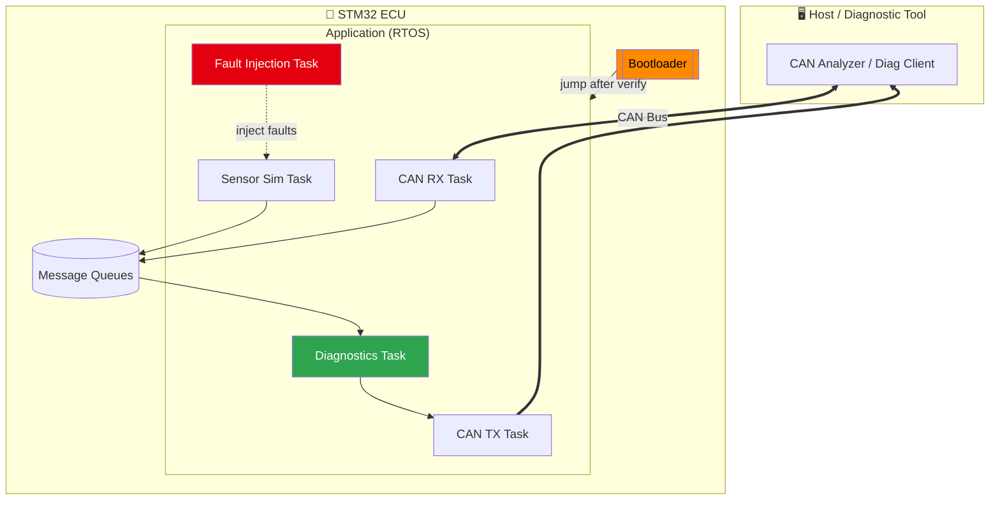
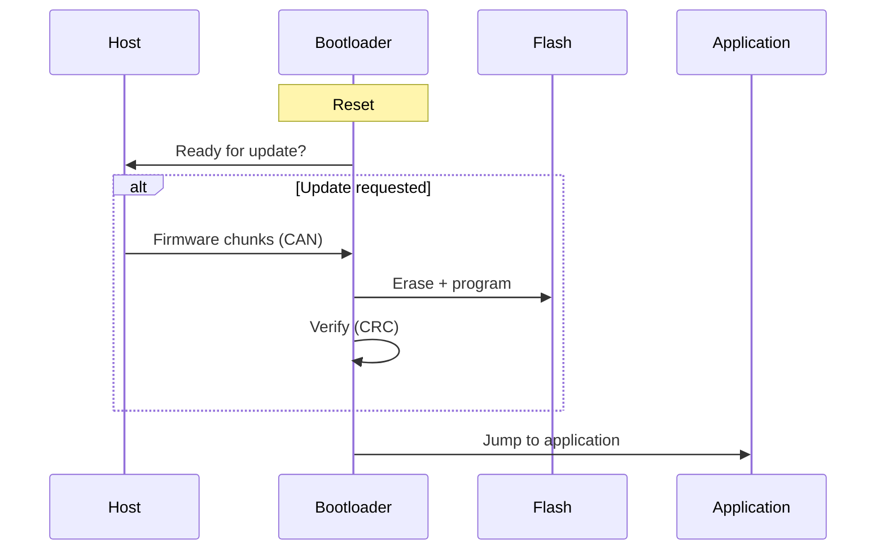
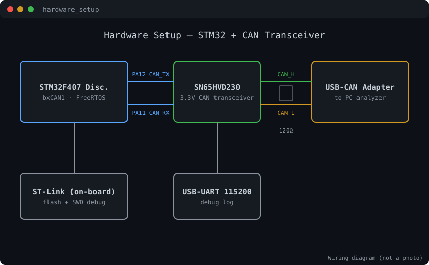
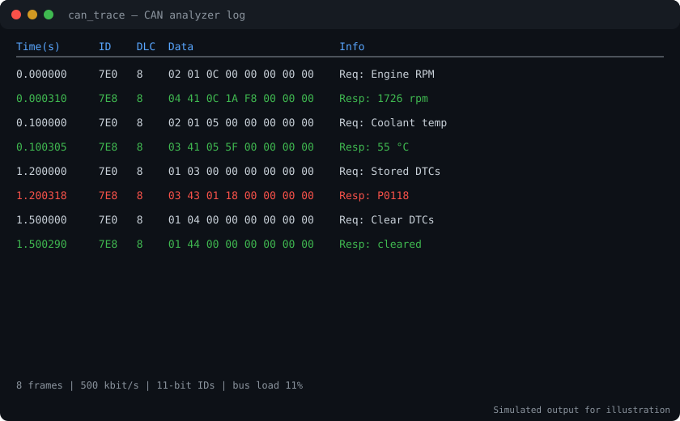
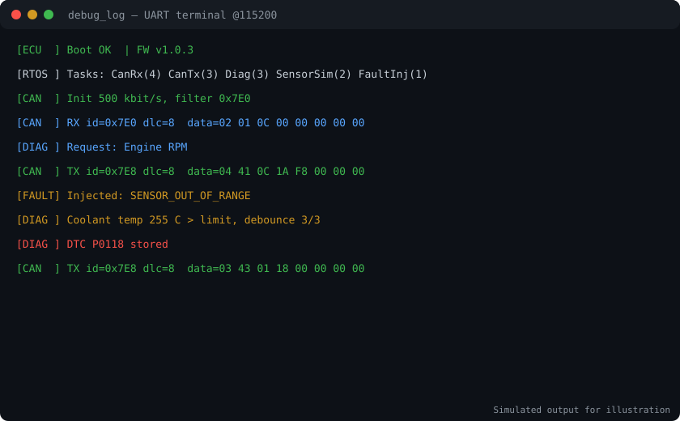
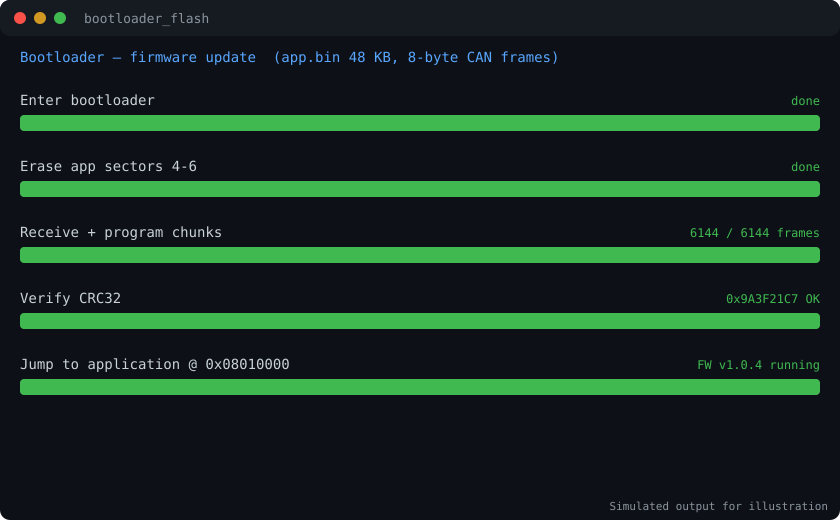
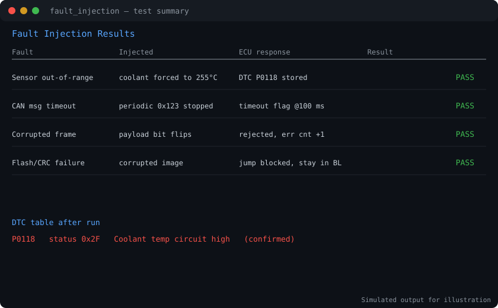
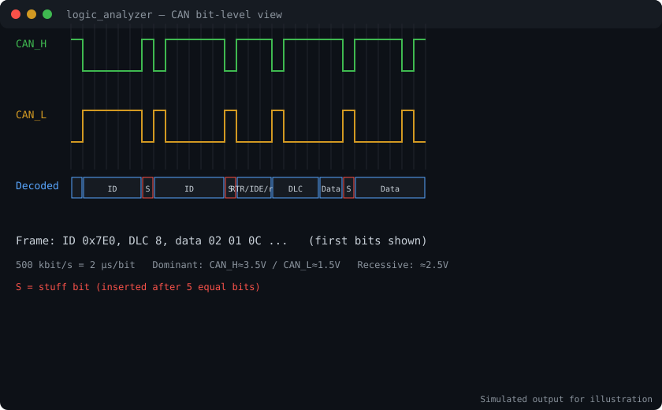

# ECU_Simulator
<div align="center">


<a href="https://git.io/typing-svg"></a>

<br/>


</div>

---

## ✦ Overview

An **automotive Electronic Control Unit (ECU) simulator** built on an **STM32** microcontroller running an **RTOS**. It communicates over **CAN Bus**, supports firmware updates through a **custom bootloader**, and includes **embedded debugging** and **fault-injection testing** to validate diagnostic behavior the way real vehicle ECUs are tested.

> 💡 *Goal: replicate the core software stack of a real ECU: real-time tasks, CAN messaging, diagnostics and safe flashing.*

---

## ✦ Highlights

| | Feature | Details |
|---|---|---|
| 🧵 | **RTOS multitasking** | Separate tasks for CAN RX/TX, sensor simulation, diagnostics |
| 🚌 | **CAN Bus** | Frame transmit/receive with filtering and diagnostic messaging |
| 💾 | **Custom Bootloader** | Receives and flashes new firmware, then jumps to the application |
| 🐞 | **Embedded Debugging** | Debug support for diagnosing firmware and bus issues |
| 💥 | **Fault Injection** | Simulated faults to test detection and reporting |
| 📈 | **Diagnostic accuracy** | Improved by **30%** *(vs. **[baseline]**)* |
| ⚡ | **Flash updates** | Accelerated by **40%** *(vs. **[baseline]**)* |

---

## ✦ System Architecture



### Boot & update flow



---

## ✦ Fault-Injection Testing

| Fault Type | How it is simulated | Expected ECU response |
|---|---|---|
| Sensor out-of-range | Force invalid value | DTC logged, flag raised |
| CAN message timeout | Stop periodic frame | Timeout detected |
| Corrupted frame / data | Bit flips in payload | Rejected, error counter increments |
| Flash/CRC failure | Corrupt image | Bootloader refuses to jump to app |

> Edit this table to match the faults you actually implemented.

---

## ✦ Output & Screenshots

> 📸 Add your captures to `docs/images/` with the names below.

<div align="center">

| Hardware Setup | CAN Bus Trace |
|:---:|:---:|
|  |  |
| *STM32 board + CAN transceiver* | *Frames captured on the bus* |

| Serial / Debug Log | Bootloader Flashing |
|:---:|:---:|
|  |  |
| *Task output and diagnostic messages* | *Firmware update in progress* |

| Fault Injection Result | Oscilloscope / Logic Analyzer |
|:---:|:---:|
|  |  |
| *DTC raised after injected fault* | *CAN waveform at bit level* |

</div>

Example log *(replace with your real output)*:

```text
[ECU] Boot OK  | FW v1.0.3
[CAN] RX id=0x7E0 dlc=8  data=02 01 0C 00 00 00 00 00
[DIAG] Request: Engine RPM
[CAN] TX id=0x7E8 dlc=8  data=04 41 0C 1A F8 00 00 00
[FAULT] Injected: SENSOR_OUT_OF_RANGE
[DIAG] DTC P0xxx stored
```

---

## ✦ Repository Structure

```text
ecu-simulator/
├── bootloader/
│   ├── src/
│   └── linker/
├── app/
│   ├── Core/
│   │   ├── Inc/
│   │   └── Src/
│   ├── can/             # CAN driver + message handling
│   ├── diag/            # diagnostics + DTC logic
│   ├── fault_inject/    # fault injection module
│   └── rtos/            # task + queue configuration
├── tools/               # host-side scripts
├── docs/images/
└── README.md
```

---

## ✦ Getting Started

**Requirements:** STM32 board (`<fill part number>`), CAN transceiver, USB-CAN adapter, STM32CubeIDE, ST-Link.

```bash
git clone https://github.com/Prathameshgirhe/<repo-name>.git
```

1. Open the project in **STM32CubeIDE**
2. Build and flash the **bootloader** first
3. Build the **application** (linked at the app offset)
4. Connect the CAN adapter and open your analyzer at the configured baud rate
5. Send diagnostic requests and watch the responses 🎉

---

## ✦ Roadmap

- [ ] UDS (ISO 14229) service coverage
- [ ] Secure bootloader (signature check)
- [ ] CAN-FD support
- [ ] Hardware-in-the-loop test automation

---

<div align="center">

### 👤 Author

**Prathamesh Girhe**
B.E. Electronics & Telecommunication · GCOEARA, Avasari Khurd

[](https://github.com/Prathameshgirhe)
[](https://linkedin.com/in/prathamesh-girhe-b6a09631a)

⭐ *If you like it, star it!*


</div>
